# docsnest: complete screen design gallery

**10 October 2026.** This extends the [UX/UI audit](UX_UI_AUDIT_2026-10-10.md) from one editor mockup to **15 design boards**: the original cloud editor plus 14 additional boards covering the main screens, dialogs and important states.

These are visual proposals, not changes to the running application. Generated imagery illustrates hierarchy and layout; the written behavior notes and existing contracts control implementation. Sample people, documents and dates are fictional. Raster lettering, exact spacing and screen-reader behavior must be implemented and tested in code. English is used in the boards for review; the audit contains Vietnamese copy guidance.

## Browse the designs

| Board                           | Screen / states                         |
| ------------------------------- | --------------------------------------- |
| [00](#00-cloud-document-editor) | Cloud rich editor, desktop and mobile   |
| [01](#01-introduction)          | Introduction                            |
| [02](#02-authentication)        | Sign-in and registration                |
| [03](#03-my-files)              | My files library                        |
| [04](#04-shared-trash)          | Shared files and Trash                  |
| [05](#05-library-states)        | Empty, search, loading and error states |
| [06](#06-markdown-code)         | Managed Markdown and code editors       |
| [07](#07-json)                  | JSON source and result                  |
| [08](#08-local-document)        | Local document editor                   |
| [09](#09-sharing)               | Sharing and collaboration               |
| [10](#10-versions-recovery)     | Version history and recovery            |
| [11](#11-file-actions)          | Create, rename, move and import         |
| [12](#12-downloads)             | Download formats and export progress    |
| [13](#13-settings-plan)         | Settings and plan management            |
| [14](#14-public-viewer)         | Public document viewing                 |

## Design system

All boards share the blue document mark, white document surfaces, a cool gray workspace, cobalt primary actions, quiet secondary controls and readable sans-serif UI text. Writing keeps the main screen area. Mobile uses compact headers, menus and single-pane switches where desktop shows side-by-side work.

Common navigation: Introduction → Local tools or Authentication → My files → Editor → Share / History / Downloads. Account contains Settings and plan management. Shared with me and Trash remain separate library scopes.

## 00. Cloud document editor

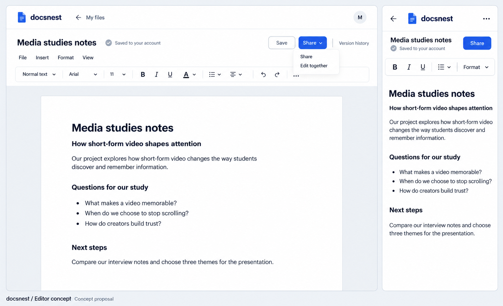

The original proposal remains the anchor: compact identity/save status, one everyday toolbar, on-demand formatting and more space to write. Saved to your account appears only after the current content is committed. Share controls are owner-specific; recipients get an access summary.

## 01. Introduction

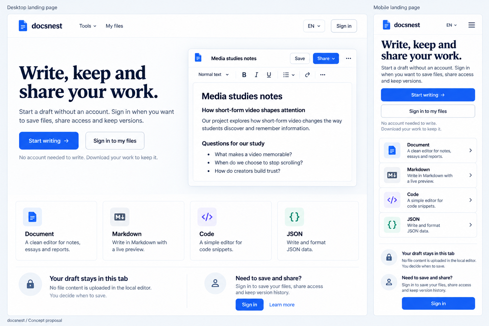

**What changes:** Two clear entry paths: write immediately, or sign in for saved files and sharing. Normal Document is the default; specialist tools sit below the main action.

**Behavior to preserve:** Start writing → local Document. Sign in → authentication → My files. The landing example represents the account editor; it must not imply anonymous cloud saving.

## 02. Sign-in and registration

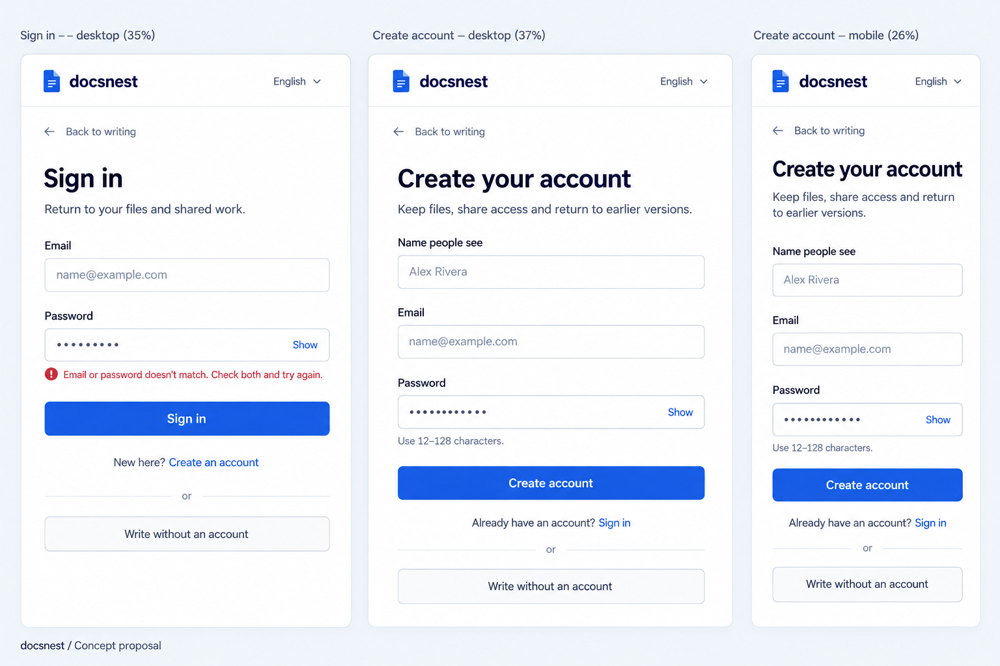

**What changes:** Sign-in, account creation and mobile registration share one form pattern. Password guidance is visible before submission and errors stay beside the relevant fields.

**Behavior to preserve:** Keep the current three required registration fields and 12–128-character password rule. No OAuth, verification or reset flow is being added by this concept.

## 03. My files library

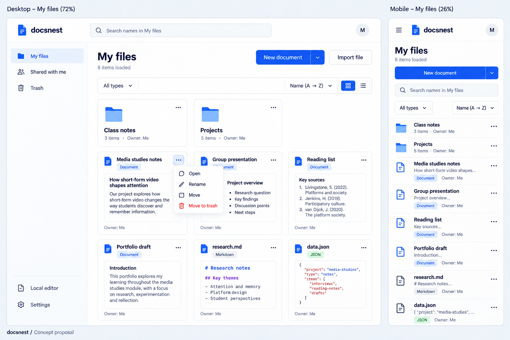

**What changes:** A populated desktop library and mobile list put New document and Import ahead of secondary file operations. Format chips distinguish documents, Markdown and JSON.

**Behavior to preserve:** Search is name-based and scoped. Name sorting applies only to loaded results until server ordering is extended. Folder item counts in the generated artwork are illustrative and should be omitted unless reliably provided; mobile Import belongs in the New menu.

## 04. Shared files and Trash

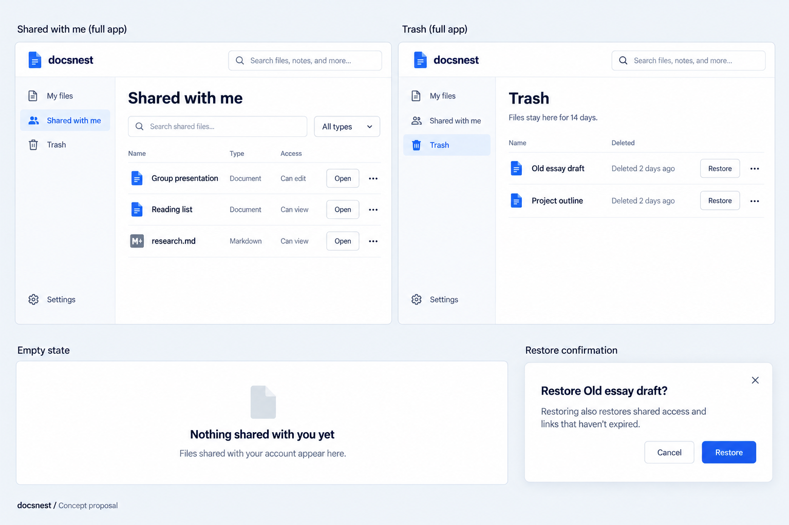

**What changes:** Shared files emphasize Can view / Can edit. Trash retains familiar library structure and makes restore consequences explicit.

**Behavior to preserve:** Use one scoped search per surface. The generated top search placeholder is not a proposal for global/content search; remove the duplicate search treatment in implementation. Restore reactivates existing grants and unexpired links.

## 05. Empty, search, loading and error states

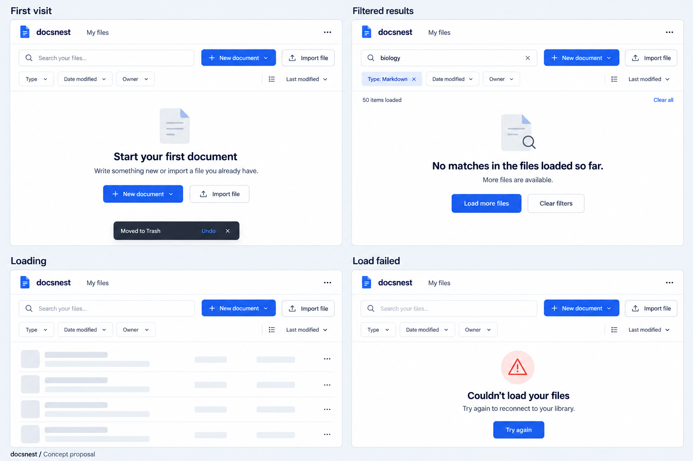

**What changes:** First visit, filtered results, loading and failed requests receive different states. Clear actions prevent errors from looking like an empty account.

**Behavior to preserve:** Show Load more when unsearched pages remain. Undo for Move to trash uses the existing restore operation and its ACL/retention rules. The toast and empty panel are independent state examples.

## 06. Managed Markdown and code editors

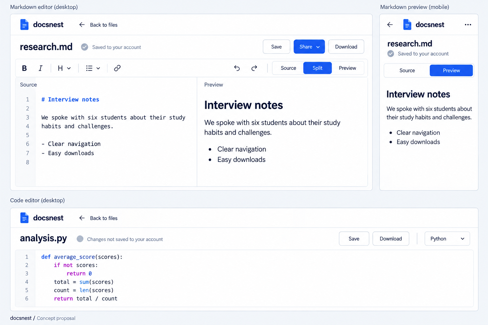

**What changes:** Managed Markdown gets an explicit Source / Split / Preview control; code gets a compact syntax-oriented editor. The mobile layout switches panes instead of stacking tall panes.

**Behavior to preserve:** Both are account files. Download preserves original format; code is never executed. Preserve source selection, undo, retained panes and bounded rendering.

## 07. JSON source and result

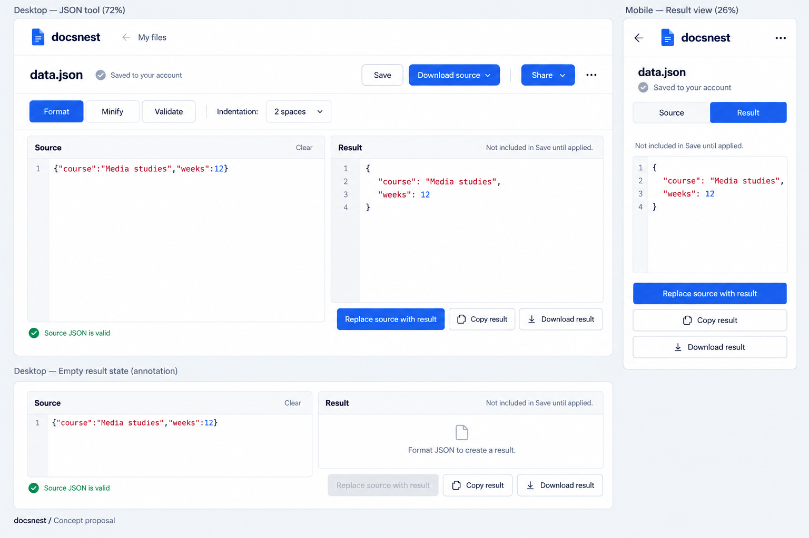

**What changes:** Source and editable result are distinct. Save applies to the source, while result actions explain replacement and downloads. A fresh empty result cannot replace nonempty source.

**Behavior to preserve:** Disable Replace source with result until a result exists. Validate the source and result independently; source validation does not certify a result that has since been edited. Preserve undo after applying.

## 08. Local document editor

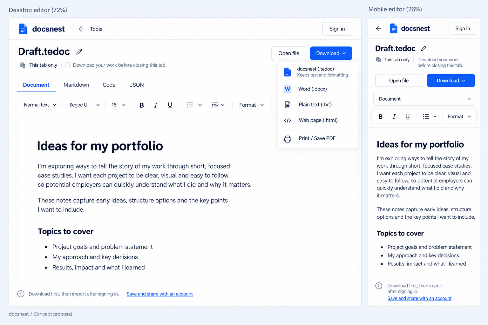

**What changes:** The local rich editor has the same visual language but a different persistence label and primary action: This tab only / Download.

**Behavior to preserve:** No Share, cloud Save or background authenticated request in local mode. Signing in does not upload the open draft. Preserve the explicit download-then-import bridge.

## 09. Sharing and collaboration

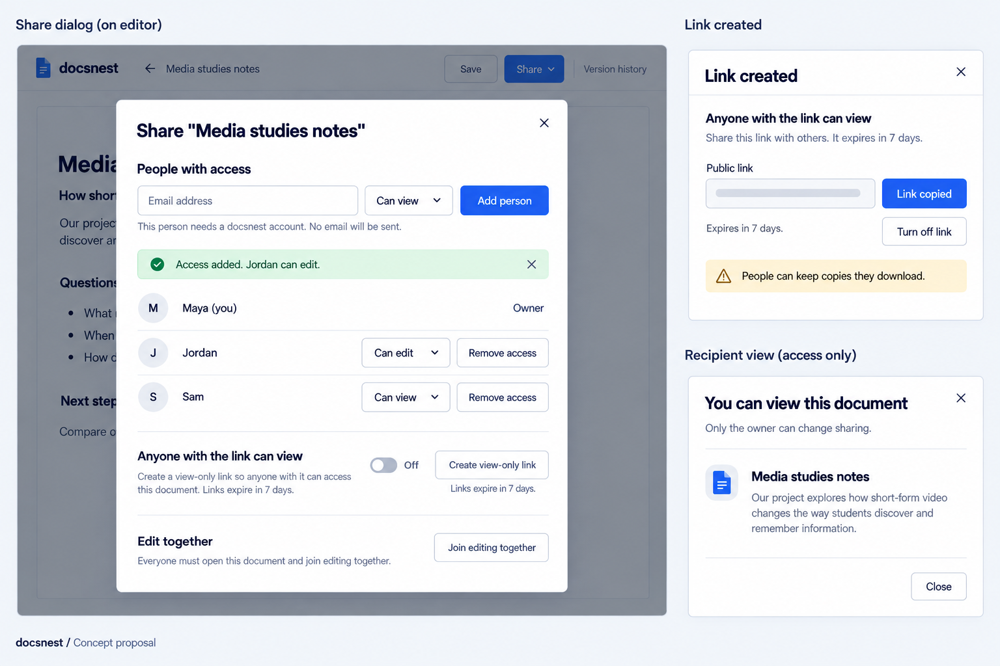

**What changes:** Owner sharing separates named-account permissions, view-only public links and explicit collaboration joining. Recipient access has a simpler read-only summary.

**Behavior to preserve:** No email is sent. Default new grants to Can view. Copy confirmation follows actual clipboard success. Creating a public link remains opt-in; Edit together still requires each eligible participant to join.

## 10. Version history and recovery

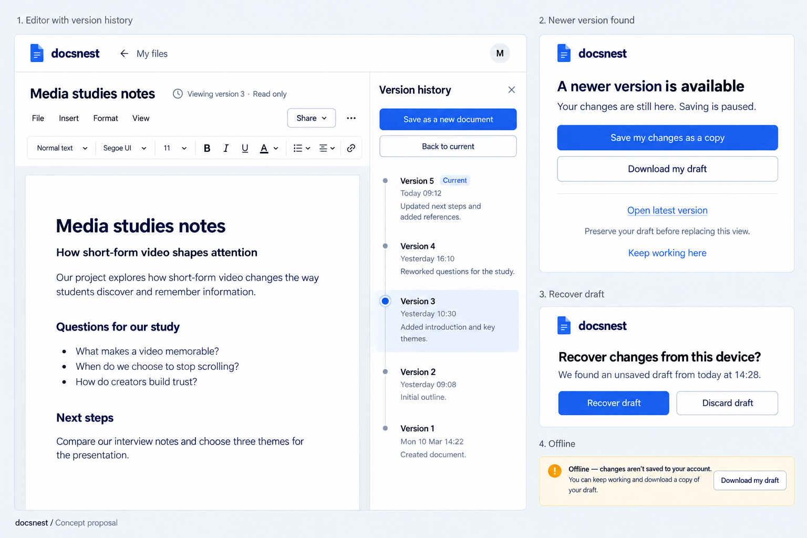

**What changes:** Version browsing stays read-only and offers a new-document copy. Conflict, recoverable draft and offline states each show the appropriate next action.

**Behavior to preserve:** Never overwrite the current version by calling a historical preview Restore. Open latest must preserve or explicitly discard local changes. Offline status does not prove a successful local checkpoint.

## 11. Create, rename, move and import

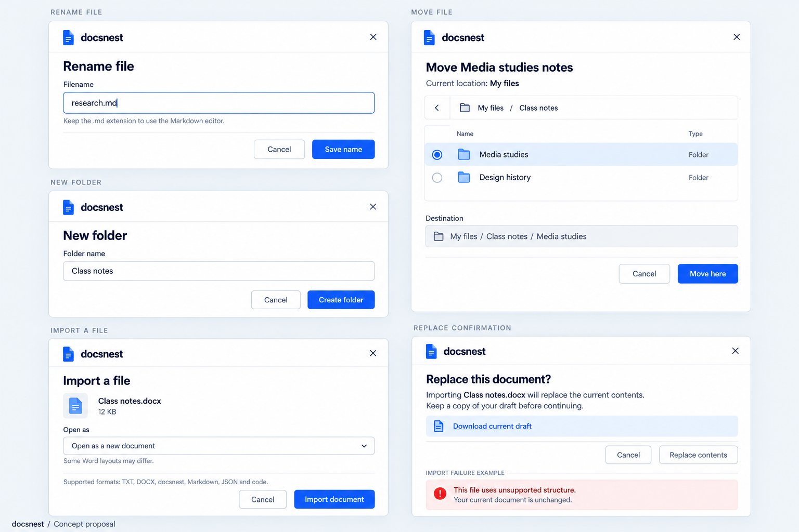

**What changes:** Rename, folder creation, hierarchical move and import each have focused dialogs. Replacing existing contents is a separate deliberate decision.

**Behavior to preserve:** Preserve filename semantics, metadata revision checks and folder-cycle rules. A failed import leaves current content intact. Do not close a mutation dialog before success.

## 12. Download formats and export progress

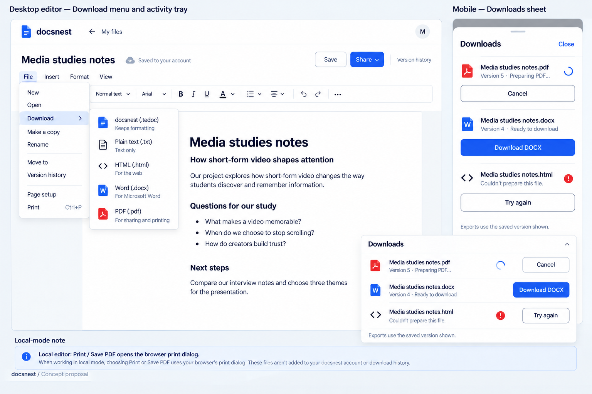

**What changes:** Users choose an output format, then see preparation, ready and failure states in a visible Downloads tray, including the exported version.

**Behavior to preserve:** Do not display invented percentages. The tray is in-session unless job-history loading is implemented. Local Print / Save PDF is browser printing, distinct from server PDF export.

## 13. Settings and plan management

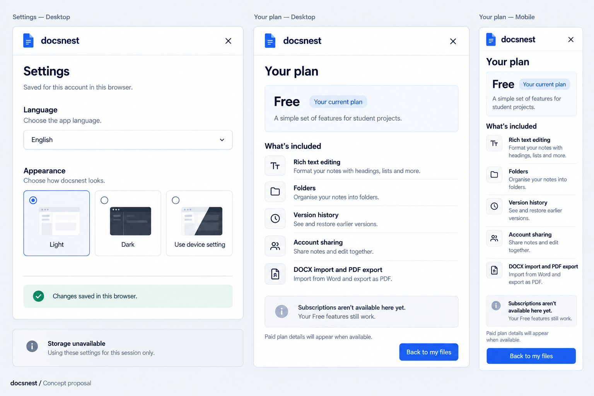

**What changes:** Settings explains browser-local preferences. Plan management puts Free and currently available capabilities first, with honest subscription unavailability.

**Behavior to preserve:** This is the current lab-state design, not an invented paid offer. Do not add prices, discounts or Pro-only benefits before the product decision and provider configuration. Storage fallback must say session-only.

## 14. Public document viewing

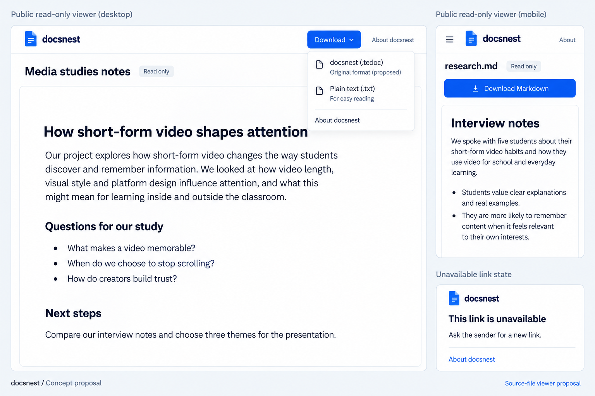

**What changes:** Public documents have reading and download controls without owner identity or private navigation. Invalid links give one useful, privacy-preserving message.

**Behavior to preserve:** The source-aware Markdown public viewer and original-extension download are proposed improvements, not existing acceptance evidence. Public access remains read-only; never execute source content.

## Screen and state coverage

| Existing area               | Boards    | Important variations                                                                               |
| --------------------------- | --------- | -------------------------------------------------------------------------------------------------- |
| Introduction                | 01        | Desktop/mobile, no-account/account paths                                                           |
| Authentication              | 02        | Sign-in, registration, field error, mobile                                                         |
| Workspace/library/folders   | 03–05, 11 | Grid/list, scoped search, filters, empty/loading/failure, create/rename/move                       |
| Shared with me / Trash      | 04        | Permission labels, no shared items, restore consequence                                            |
| Cloud rich editor           | 00        | Desktop/mobile, save state and compact tools                                                       |
| Local editors               | 06–08     | Local rich shown in 08; source tool layout in 06/07 with local persistence variant described below |
| Markdown / Code             | 06        | Split preview, single-pane mobile, syntax editing                                                  |
| JSON                        | 07        | Source/result, scratch output, empty-result guard                                                  |
| Sharing / collaboration     | 09        | Owner, recipient, public link, copied state, explicit room join                                    |
| History / recovery          | 10        | Older read-only version, new copy, conflict, draft recovery, offline                               |
| Import / file actions       | 11        | New import, replace existing, rejection, hierarchical destination                                  |
| Exports                     | 12        | Formats, running, ready, failed, mobile tray, local print distinction                              |
| Preferences / subscriptions | 13        | Appearance/language, storage fallback, Free and unavailable subscription state                     |
| Public viewer               | 14        | Rich reading, proposed Markdown view, unavailable link                                             |

For **local Markdown, Code and JSON**, reuse the pane layouts in 06/07 with the local shell from 08: This tab only, Open file, Download; no cloud Save/Share/History. For **managed JSON**, Save writes the source, not the scratch result. These are context variants, not separate products.

## Responsive and interaction handoff

- At 390px, prioritize title, state, current action and editing content; move language/theme and advanced formatting into accessible menus/sheets.
- Keep field labels visible and status messages near the related action. Use full-width actions when a narrow inline row would truncate meaning.
- Source/preview and JSON source/result switch views on narrow screens but retain both underlying editors and histories.
- Modals need initial/return focus, keyboard containment, Escape handling where safe and background inertness. Generated images do not establish accessible behavior.
- Keep permission-gated controls consistent across rich and source files, and use existing APIs to preserve ACL, optimistic revision, idempotency and snapshot guarantees.
- Empty, unavailable, failed and loading are different states. Share success, cloud save completion and download readiness require actual operation results.

## Implementation order

1. Mobile editing shell, clear persistence labels, form guidance, dialogs and empty/error states.
2. Library creation/search scope, shared access, Trash and file operations.
3. Source/result layouts, export feedback, public source viewing and version/recovery panels.
4. Commercial subscription design only after the plan benefits, prices and acceptance gates are resolved.

The audit remains the detailed behavior/copy specification. [All new image prompts](ALL_SCREENS_IMAGE_PROMPTS.md) record the built-in imagegen inputs; [original editor prompt](UX_AUDIT_IMAGE_PROMPT.md) records board 00. Full-resolution PNGs are under `docs/design/assets/` and `docs/design/assets/screens/`. Execution results belong only in [PROJECT_STATUS.md](../PROJECT_STATUS.md).
